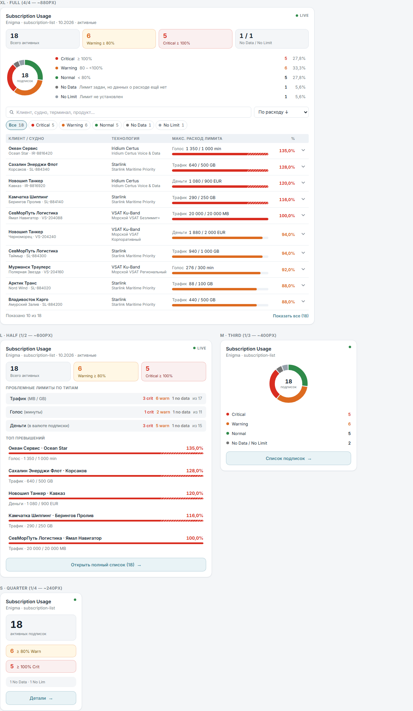
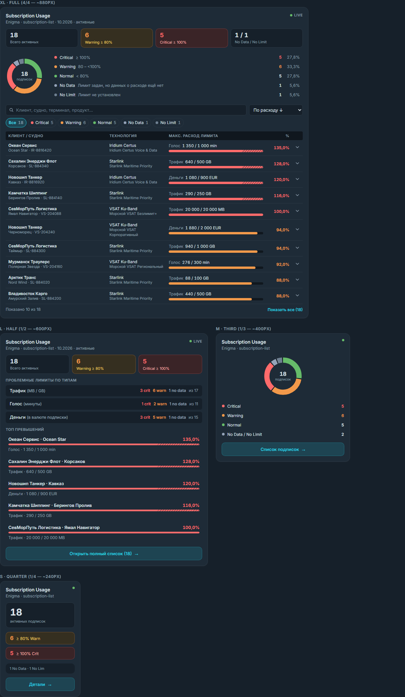
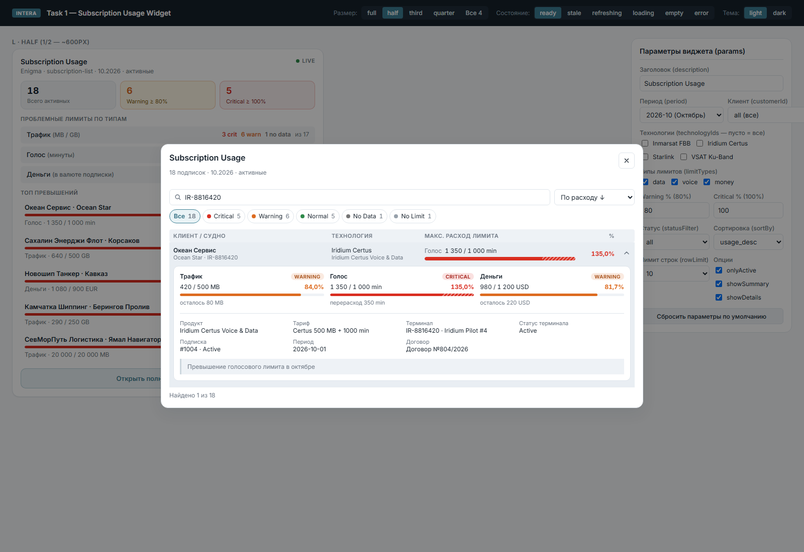
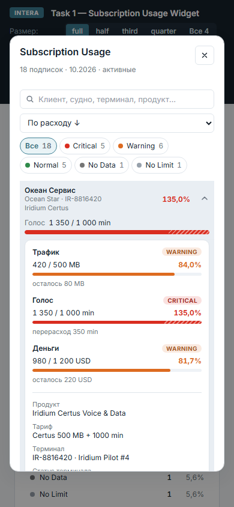

# Subscription Usage Widget: решение

**Демо песочницы:** https://nikolayyaroslavcev.github.io/intera/ (собирается из `main` через GitHub Actions после typecheck и тестов).

Исходное задание в [README.md](./README.md). Здесь описано, что сделано, как это устроено и какие решения я принял там, где спецификация допускает разные трактовки.



## Запуск

```bash
npm install
npm run dev        # песочница: размеры, состояния данных, темы, все params
npm test           # 152 теста: params, compute, форматирование, компонент
npm run typecheck
npm run build
```

## Структура

```
src/widget/
  subscription-usage-params.ts    params (unknown) → ISubscriptionUsageConfig
  subscription-usage-compute.ts   чистая доменная логика, без React и DOM
  subscription-usage-format.ts    подписи, форматирование чисел и единиц
  use-list-controls.ts            интерактивное состояние: поиск, фильтры, раскрытые строки
  subscription-usage.tsx          корень: состояния данных, выбор раскладки, модальный список
  subscription-usage.css          стили только на токенах темы INTERA
  parts/
    size-views.tsx                FullView / HalfView / ThirdView / QuarterView
    subscription-table.tsx        поиск, быстрые фильтры, сортировка, таблица
    limit-details.tsx             раскрытая подписка: все три лимита и атрибуты
    summary-blocks.tsx            плитки KPI, легенда, разбивка по типам, топ превышений
    status-donut.tsx              кольцевая диаграмма (SVG, pathLength=100)
    list-dialog.tsx               модальный список на нативном <dialog>
    state-blocks.tsx              скелетон, ошибка, пустые состояния
    usage-bar.tsx, status-badge.tsx, class-names.ts
```

Зависимости идут в одну сторону: `params → compute → format → view`. Compute не знает про React, view не считает статусы сам и только отображает результат `computeSubscriptionUsage`.

## Доменная логика

Правила спецификации реализованы как маленькие экспортируемые функции, у каждой свои тесты:

- `evaluateLimit` отвечает за один лимит. Если `allowance` равен `null`, `''`, `<= 0` или `-1`, статус `no_limit`. Если лимит задан, а `used` отсутствует или отрицательный, статус `no_data`, и процент не считается нулём. Пороги включительные: ровно 80% даёт warning, ровно 100% даёт critical.
- `resolveDataLimit` выбирает пару GB или MB по правилу из README. Значения MB и GB никогда не складываются.
- `evaluateSubscription` вычисляет общий статус по приоритету `critical > warning > normal > no_data > no_limit` только среди `config.limitTypes`. `primaryLimit` хранит лимит, который определил статус; при равенстве статусов берётся больший процент.
- `computeSubscriptionUsage` работает по конвейеру: scope-фильтры → `summary` → поиск → `statusFilter` → сортировка → срез `rowLimit`.

Все числа из строк проходят через `toFiniteNumber`, `Number(v)` не используется нигде.

Процент считается как `used * 100 / allowance`. Математически это то же самое, что `(used / allowance) * 100`, но для целых входов результат точный: 440 / 500 даёт `88`, а не `88.00000000000001`. Значение, которое лежит ровно на пороге, классифицируется без ошибки округления.

## Решения по неоднозначностям

### Фикстура и стартовый тест

В `mock-subscriptions.json` 22 строки, а не 20, как написано в README и в комментарии стартового теста: 18 за октябрь, 3 за сентябрь и 1 отключённая. Тест ожидал `total = 19`. Это число не получается ни из данных, ни из спецификации: по правилу `onlyActive` выходит 22 − 1 = 21. Я исправил ожидание на 21 и добавил в тест проверку длины фикстуры, чтобы такое расхождение больше не прошло молча. Подгонять логику под 19 значило бы нарушить спецификацию.

### Числа строками в params

`customerId`, `technologyIds`, пороги и `rowLimit` принимают и числовые строки (`"214"`, `"50"`): в YAML числа часто оказываются в кавычках. `null`, `''` и мусор дают значение по умолчанию.

### period

`period` нормализуется до `YYYY-MM` (`'2026-10-01'` → `'2026-10'`). Невалидный месяц (`2026-13`) превращается в `'all'`. Строки без `allowance_period` при выбранном периоде не попадают в выборку.

### `summary` не зависит от поиска

Сводка считается по scope-фильтрам из params, то есть до `statusFilter`, поиска и `rowLimit`. Иначе KPI и диаграмма менялись бы при каждом нажатии клавиши в поиске. Количество найденных показывается отдельно: «Показано 10 из 18».

### byLimitType

`byLimitType` считается только по включённым в `limitTypes` измерениям, у выключенных остаются нули. В `withLimit` попадает число подписок с положительным лимитом данного типа.

### Runtime-фильтр

Runtime-фильтр расширен полями `statusFilter` и `sortBy`: это быстрые фильтры внутри виджета. Начальные значения берутся из params, а при изменении params состояние пересинхронизируется (паттерн «adjust state on prop change», без лишнего эффекта).

### Поиск

Поиск разбивает запрос на слова, и каждое слово должно найтись хотя бы в одном из пяти полей из README. Регистр не учитывается, `ё` приравнивается к `е`. Ввод идёт через `useDeferredValue`, поэтому поле поиска не подтормаживает на больших списках.

### showSummary

`showSummary` управляет сводкой в `full` и `half`. Раскладки `third` и `quarter` и есть сводка, поэтому в них параметр не применяется.

### showDetails = false

`showDetails = false` убирает раскрытие строк. Полный список при этом остаётся доступным: это навигация, а не детали подписки.

### Модальный список

Модальный список в `half`, `third` и `quarter` (и «Показать все» в `full`, когда строк больше `rowLimit`) показывает все отфильтрованные подписки без среза `rowLimit`. Иначе из компактной карточки до части подписок было бы не добраться.

## Состояния данных

| Состояние | Поведение |
|---|---|
| `loading && !loaded`, ошибки нет | скелетон в форме конкретной раскладки, `aria-busy`; «Нет подписок» не показывается |
| `error && !loaded` | блок ошибки с текстом `data.error`, `role="alert"`, в том числе пока идёт повторная попытка |
| `loading && loaded` | вид не размонтируется: поиск, фильтры, раскрытые строки и открытый список сохраняются; добавляются тонкая полоса прогресса и пометка «Обновление» |
| `stale` | `<FreshnessMark source="rows" stale />` в шапке |
| `error && loaded` | данные остаются на экране, сверху ненавязчивая плашка о неудачном обновлении |
| пустой источник | «Нет подписок» |
| пустая выборка по params | «Нет подписок по параметрам» с описанием фильтров |
| поиск или фильтр ничего не нашёл | «Ничего не найдено» и кнопка сброса |

Всё интерактивное состояние живёт в корне виджета, а корень при фоновом обновлении не размонтируется. Это покрыто тестом: поиск и раскрытая строка переживают переход в `loading && loaded`.

## UI

- Раскладки повторяют `reference-layout.svg`. `full`: четыре плитки KPI, кольцевая диаграмма с легендой (клик по строке легенды включает фильтр), поиск, чипы статусов со счётчиками, сортировка, таблица с раскрытием всех трёх лимитов. `half`: три плитки, проблемные лимиты по типам, топ-5; клик по подписке открывает список, уже отфильтрованный по ней, с раскрытыми деталями. `third`: кольцо со счётчиками. `quarter`: крупный KPI и бейджи.
- Цвета берутся только из токенов `theme.css`. Каждый статус задаёт одну переменную `--su-tone` через `[data-status]`, и все элементы читают её. Поэтому светлая и тёмная темы работают без отдельных переопределений.
- Помимо `data-size`, раскладка подстраивается под фактическую ширину через container queries: на узкой ширине колонка «Технология» уходит под название, плитки перестраиваются. Сам модальный список тоже container, поэтому таблица внутри него не наследует ширину карточки 240px.
- Перерасход больше 100% обозначен штриховкой на конце полосы, чтобы 135% визуально отличалось от 100%.
- Процент округляется до десятых, но не через целое число вверх: 99,96% показывается как 99,9%, потому что статус у него ещё warning.
- `theme.css` объявляет шрифт Inter, но в стартовом проекте его никто не подключал, и песочница рисовала системным шрифтом. Я подключил Inter в `index.html` песочницы. Сам виджет шрифты не грузит, это задача хост-страницы.
- В песочнице правая панель на широком экране выходила за край: колонки `1fr 1fr` не сжимались уже длинных названий клиентов в селекте. Поправил на `minmax(0, 1fr)`, горизонтальной прокрутки больше нет.
- Доступность: семантическая таблица, `aria-expanded` и `aria-controls` на строках, `aria-pressed` на фильтрах, текстовая альтернатива у диаграммы, видимый `:focus-visible`, нативный `<dialog>` (фокус, `Esc`, клик по фону), `prefers-reduced-motion`.




На ширине телефона строки таблицы складываются в двухстрочные карточки:



## Тесты

- `subscription-usage-params.test.ts`: значения по умолчанию, мусор на входе, пороги (кламп и сброс), `limitTypes`, `rowLimit`/`maxRows`, нормализация периода и `customerId`.
- `subscription-usage-compute.test.ts`: каждый инвариант на синтетических строках плюс все граничные случаи фикстуры (ровно 80% и 100%, строки, `-1`, GB+MB, `null` в расходе, перерасход денег), сводка, поиск, сортировки, неизменность входных данных.
- `subscription-usage-format.test.ts`: округление процентов у порогов, описания лимитов («нет данных» вместо нуля), склонения.
- `subscription-usage-widget.test.tsx` (jsdom): все состояния данных (включая ошибку во время повторной загрузки), четыре размера, сохранение поиска и раскрытой строки при фоновом обновлении, быстрые фильтры, `showDetails`, модальный список, сброс поиска при повторном открытии списка.
- `subscription-usage.test.ts`: стартовые тесты с исправленным ожиданием (см. выше).
